# 🛡️ Microsoft Sentinel Threat Detection & SIEM Engineering Lab

<p align="center">
  
  
  
  
  
  
  
</p>

> An end-to-end cloud SIEM, detection engineering, and incident response lab built in Microsoft Azure. Deployed a live Windows honeypot, collected host telemetry via Azure Monitor Agent (AMA), simulated real-world adversary attacks from Kali Linux, authored 6 custom KQL analytics rules mapped to MITRE ATT&CK, performed visual graph triage, built an interactive SOC operations dashboard, and automated triage commentary with Azure Logic Apps.

---

## 📖 Table of Contents

* [📌 Project Overview](#-project-overview)
* [🎯 Project Objectives](#-project-objectives)
* [⚙️ Environment & Tech Stack](#-environment--tech-stack)
* [🏗️ Architecture & Telemetry Pipeline](#-architecture--telemetry-pipeline)
* [⚔️ Security Mindset: Attack Execution & Boundary Validation](#-security-mindset-attack-execution--boundary-validation)
* [🔍 Telemetry Ingestion & Pipeline Verification](#-telemetry-ingestion--pipeline-verification)
* [🛡️ Custom Detection Engineering (KQL Rules)](#-custom-detection-engineering-kql-rules)
* [🚨 Incident Triage & Visual Graph Investigation](#-incident-triage--visual-graph-investigation)
* [📊 Interactive SOC Operations Dashboard (Workbook)](#-interactive-soc-operations-dashboard-workbook)
* [⚡ SOAR Automated Incident Response (Azure Logic Apps)](#-soar-automated-incident-response-azure-logic-apps)
* [🗺️ MITRE ATT&CK Mapping Matrix](#-mitre-attck-mapping-matrix)
* [⚖️ Home Lab vs. Production Strategy](#-home-lab-vs-production-strategy)
* [📁 Repository Structure](#-repository-structure)
* [📸 Complete Evidence Index (24 Verified Artifacts)](#-complete-evidence-index-24-verified-artifacts)
* [💡 Key Takeaways & Lessons Learned](#-key-takeaways--lessons-learned)
* [🛠️ Skills Demonstrated](#-skills-demonstrated)
* [🚀 Future Improvements & Roadmap](#-future-improvements--roadmap)
* [📚 References](#-references)
* [👤 Author](#-author)

---

## 📌 Project Overview

Most SIEM labs rely on synthetic, canned logs or clicking through pre-configured vendor templates. In contrast, this lab was designed as an authentic **Purple-Team detection engineering exercise** built from bare ground in Microsoft Azure:

1. **Offensive (Red):** Deployed a Windows 10 honeypot VM directly exposed to the public internet. Used Kali Linux tools (**Nmap**, **THC-Hydra**) to execute automated RDP dictionary brute-force attacks, followed by post-exploitation persistence via backdoor account creation, local administrator group elevation, obfuscated Base64 PowerShell execution, and anti-forensic security log clearing.
2. **Defensive (Blue):** Ingested all Windows security events into a Log Analytics Workspace using the modern **Azure Monitor Agent (AMA)** and custom **Data Collection Rules (DCR)**. Authored 6 production-grade KQL analytics rules that correlate events, filter out local loopback and system noise, map entities (Host, Account, IP), and trigger incidents in Microsoft Sentinel.
3. **Response & Automation:** Triaged incidents using Sentinel's **Visual Investigation Graph**, developed an interactive **SOC Operations Workbook** with live 3D geospatial attack mapping, and created a serverless **Azure Logic App Playbook** to automate tier-1 incident enrichment and analyst guidance.

---

## 🎯 Project Objectives

* Provision and secure cloud infrastructure in Microsoft Azure under strict cost governance ($0 out-of-pocket).
* Configure the modern Azure Monitor Agent (AMA) and custom Data Collection Rules (DCR) for Windows security event logging.
* Simulate adversary tactics across Initial Access, Execution, Persistence, Privilege Escalation, and Defense Evasion.
* Validate ingestion pipelines by querying raw security events in KQL before rule deployment.
* Write production-ready scheduled KQL analytics rules with entity mapping and false-positive suppression.
* Conduct root-cause incident triage using Sentinel's Visual Investigation Graph to trace adversary lineage.
* Build an interactive SOC workbook resolving attacker coordinates onto a 3D geospatial map.
* Deploy a serverless SOAR playbook via Azure Logic Apps to post automated triage comments to incident timelines.

---

## ⚙️ Environment & Tech Stack

| Component | Technology / Resource | Specifications / Details |
| :--- | :--- | :--- |
| **Cloud Provider** | Microsoft Azure | Azure for Students subscription |
| **Resource Group** | `rg-sentinel-lab` | Region: `East Asia` |
| **SIEM Platform** | Microsoft Sentinel | Built on top of Log Analytics Workspace |
| **Workspace** | `law-sentinel-lab-01` | Daily cap & auto-retention configured |
| **Telemetry Pipeline** | Azure Monitor Agent (AMA) | Data Collection Rule: `dcr-windows-security-events` (`AllEvents`) |
| **Honeypot Host** | Windows 10 Pro VM (`vm-honeypot`) | `Standard_B2ats_v2` (2 vCPUs, 1 GiB RAM), Public IP: `104.208.94.95` |
| **Network Security** | Azure NSG (`Danger_Allow_All_Inbound`) | TCP Port 3389 (RDP) opened wide to the Internet |
| **Attack Platform** | Kali Linux 2026.x VM | Tools: `Nmap`, `THC-Hydra`, custom dictionary wordlists |
| **Automation (SOAR)** | Azure Logic Apps | Plan: Consumption (Serverless, pay-per-execution = $0.00) |
| **Language** | Kusto Query Language (KQL) | Advanced summarization, geo-functions, and joins |

---

## 🏗️ Architecture & Telemetry Pipeline

```
 [ Public Internet Traffic ]                    [ External Kali Linux Rig ]
 (Automated Scanners & Bots)                    (Targeted Purple-Team Attacks)
              │                                                │
              └───────────────────────┬────────────────────────┘
                                      ▼ Inbound TCP 3389 (RDP)
                      [ Windows Honeypot VM: vm-honeypot ]
                   (Public IP: 104.208.94.95 | East Asia)
                                      │
                                      ▼ (Azure Monitor Agent via DCR)
[ Entra ID Sign-in Logs ] ──► [ Log Analytics Workspace ] ──► [ Microsoft Sentinel ]
                                 (law-sentinel-lab-01)                 │
                                                                       ▼
                                                             [ 6 Custom KQL Rules ]
                                                          (MITRE ATT&CK Mapped)
                                                                       │
                                                                       ▼
                                                             [ Incidents & Alerts ]
                                                                       │
                                      ┌────────────────────────────────┴────────────────────────────────┐
                                      ▼                                                                 ▼
                         [ Visual Investigation Graph ]                                 [ Azure Logic App Playbook ]
                          (Entity Pivoting & Lineage)                                   (playbook-incident-auto-triage)
```

### Initial Environment Deployment
1. Provisioned the Resource Group `rg-sentinel-lab` and Log Analytics Workspace `law-sentinel-lab-01` in **East Asia** to bypass student policy quota restrictions encountered in `East US`.
2. Initialized Microsoft Sentinel on top of the workspace.
3. Deployed `vm-honeypot` with an exposed Network Security Group allowing inbound RDP (3389).
4. Disabled the guest Windows Defender Firewall via Azure RunCommand to allow raw packet probing:
   ```powershell
   Set-NetFirewallProfile -Profile Domain,Public,Private -Enabled False
   ```
5. Configured Data Collection Rule `dcr-windows-security-events` streaming all security events to Sentinel.

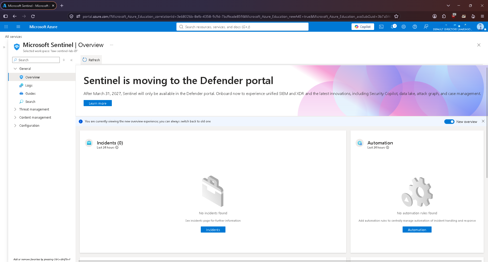
*Microsoft Sentinel initialized on the Log Analytics Workspace with a 0-incident clean baseline.*

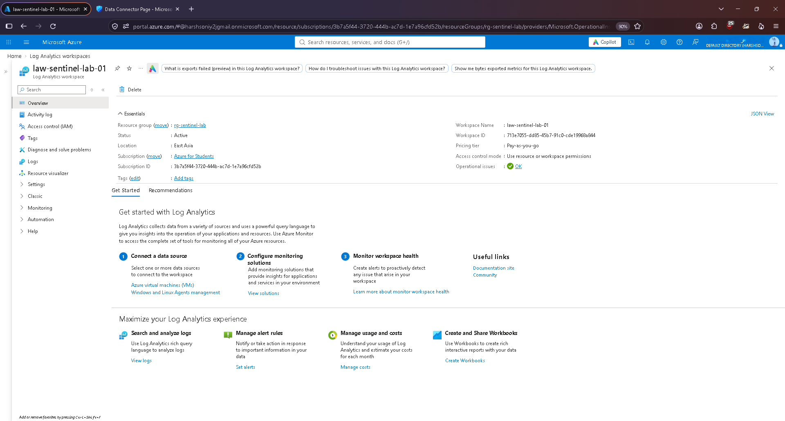
*Log Analytics Workspace (law-sentinel-lab-01) deployed in East Asia.*

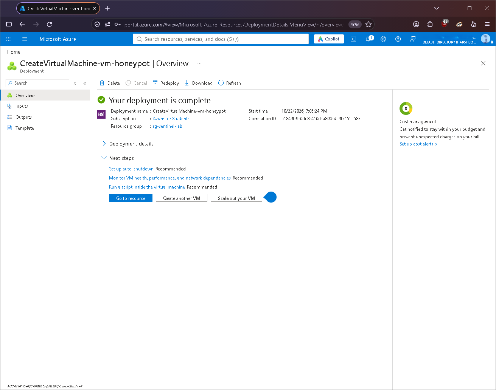
*Honeypot virtual machine successfully deployed and bound to public IP 104.208.94.95.*

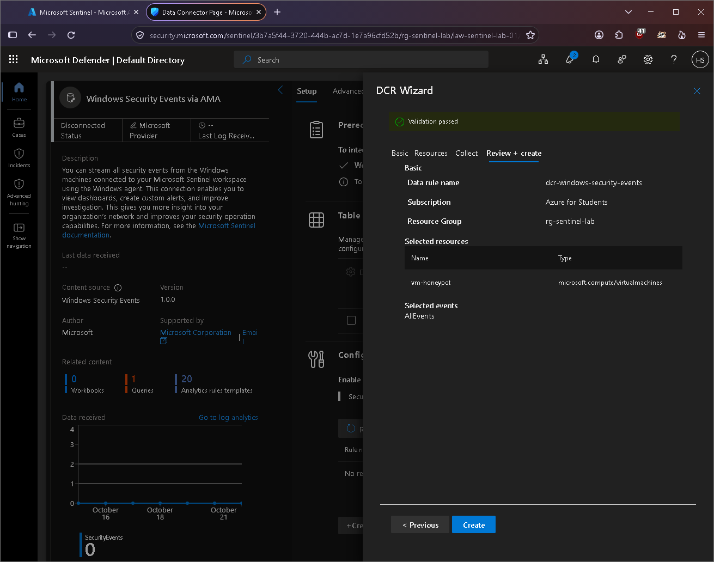
*Data Collection Rule configured and validated to collect all Windows security events.*

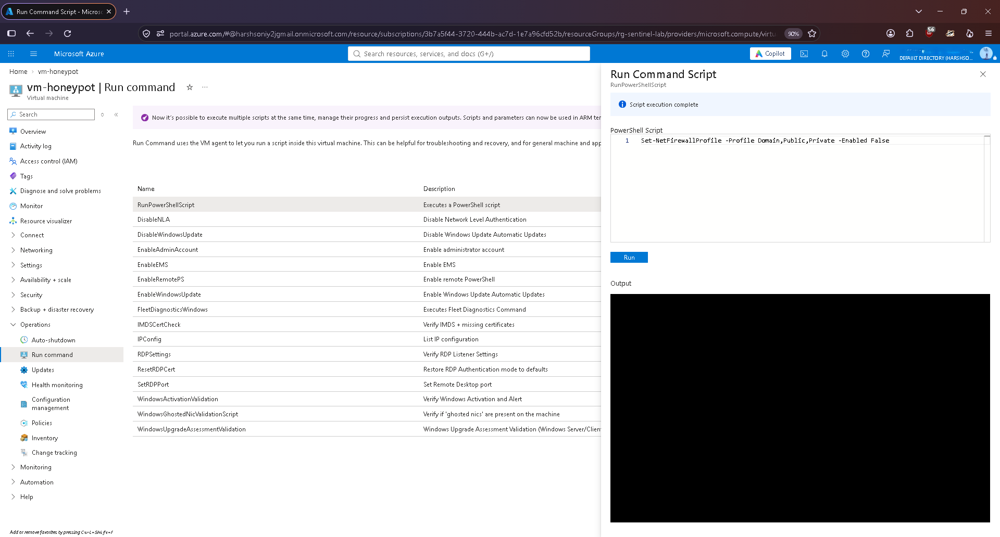
*Guest firewall disabled via PowerShell RunCommand to expose RDP directly to external scans.*

---

## ⚔️ Security Mindset: Attack Execution & Boundary Validation

Rather than trusting configurations or looking at simulated mock events, I executed real attack campaigns from my external Kali Linux machine and validated the resulting telemetry at each stage.

### Phase 1: Reconnaissance & RDP Password Brute-Forcing
From Kali Linux, I probed port 3389 and fired THC-Hydra against the `administrator` account using a password dictionary:

```bash
# Reconnaissance: Verify port 3389 is listening and exposed
nmap -Pn -p 3389 104.208.94.95

# Execution: Launch dictionary brute-force attack
hydra -t 1 -V -l administrator -P passwords.txt rdp://104.208.94.95
```

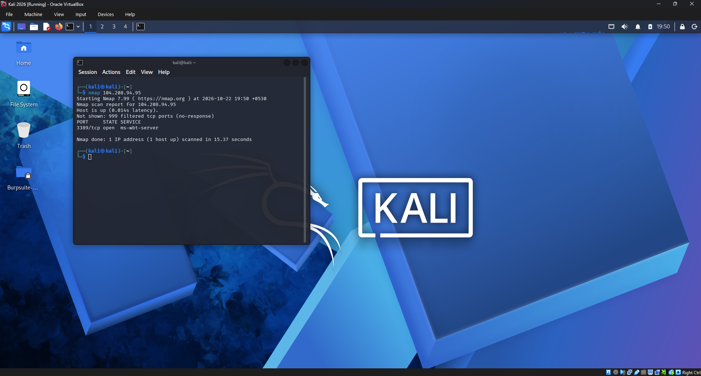
*Nmap confirming TCP port 3389 open and reachable from the external Kali Linux machine.*

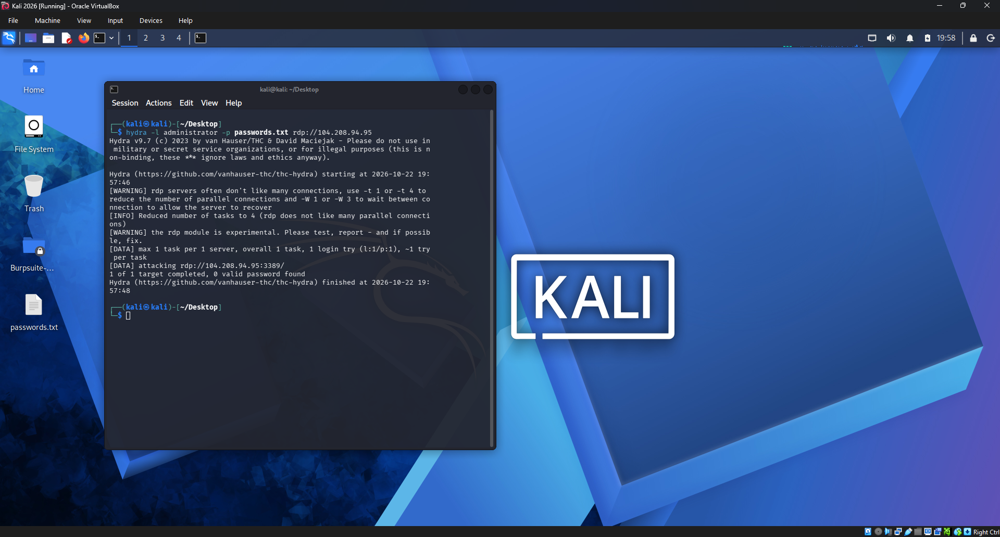
*THC-Hydra brute-forcing the Azure VM using the custom password list.*

### Phase 2: Administrative Persistence & Backdoor Creation
Simulating post-compromise actions, I executed host commands to create a local backdoor user and escalate it into the local `Administrators` security group:

```cmd
net user backdoor_guest P@ssw0rd998877! /add
net localgroup administrators backdoor_guest /add
```

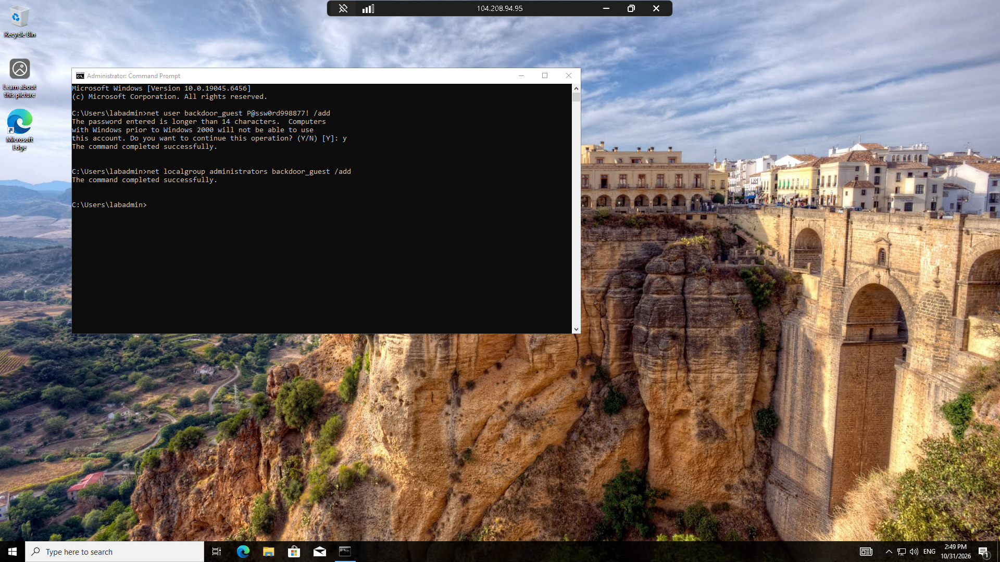
*Executing user creation and administrative group escalation on the honeypot host.*

### Phase 3: Obfuscated PowerShell Execution
Adversaries encode commands in Base64 and run non-interactive hidden processes to evade signature-based detection:

```cmd
powershell -nop -w hidden -enc VwByAGkAdABlAC0ASABvAHMAdAAgACIASABhAGMAawBlAHIAIABwAGEAeQBsAG8AYQBkACAAZQB4AGUAYwB1AHQAZQBkACIA
```

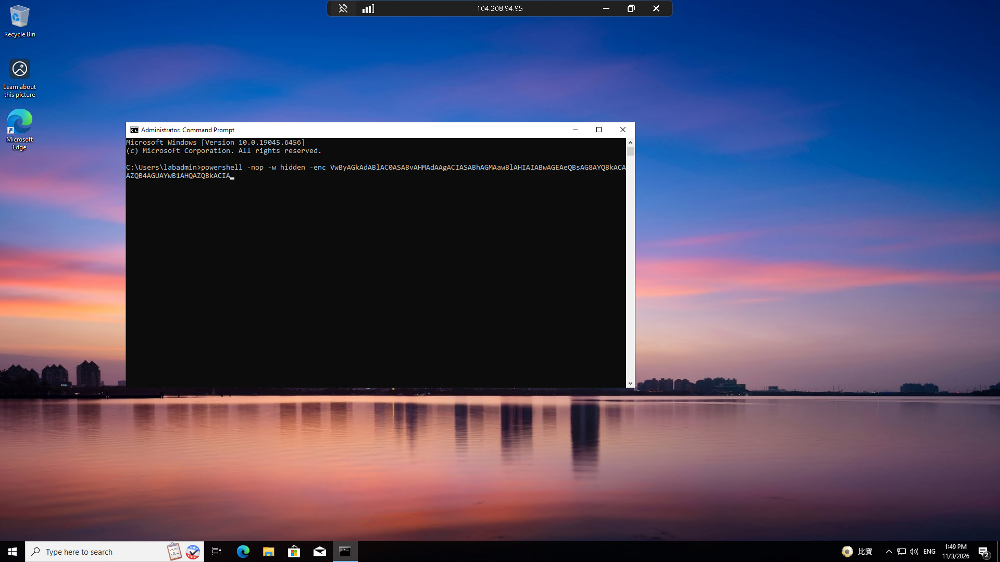
*Executing Base64-encoded, hidden-window PowerShell on the host.*

### Phase 4: Anti-Forensics Security Event Log Wiping
Before disconnecting or moving laterally, adversaries attempt to delete security event logs to eliminate forensic artifacts:

```cmd
wevtutil cl Security
```

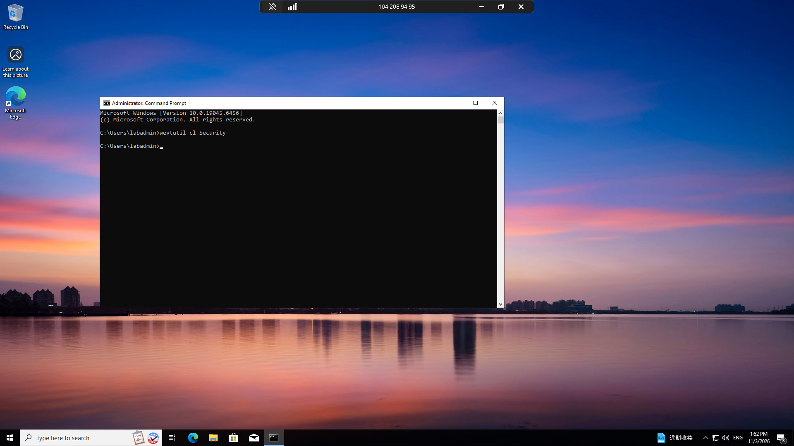
*Executing audit log clearing on the honeypot (which logs Event ID 1102 prior to log clearing).*

---

## 🔍 Telemetry Ingestion & Pipeline Verification

Before authoring scheduled analytics rules, I queried the `SecurityEvent` table in Sentinel to confirm that the telemetry arrived with the necessary fields (`Account`, `IpAddress`, `SubStatus`, `EventID`).

```kql
SecurityEvent
| where EventID == 4625
| order by TimeGenerated desc
| project TimeGenerated, Computer, Account, IpAddress, SubStatus
```

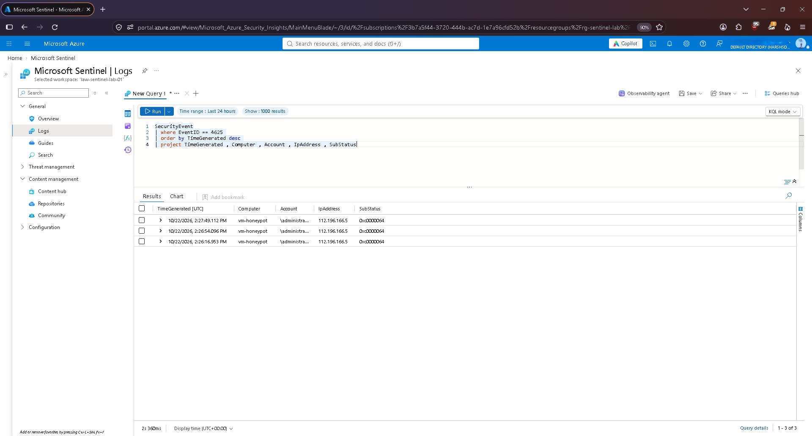
*Sentinel log query showing raw Event ID 4625 brute-force telemetry originating from the Kali IP (`112.196.156.5`) with failure status `0xc0000064` (unknown username).*

```kql
SecurityEvent
| where EventID in (4720, 4732)
| project TimeGenerated, Computer, EventID, Activity, TargetUserName, SubjectUserName
```

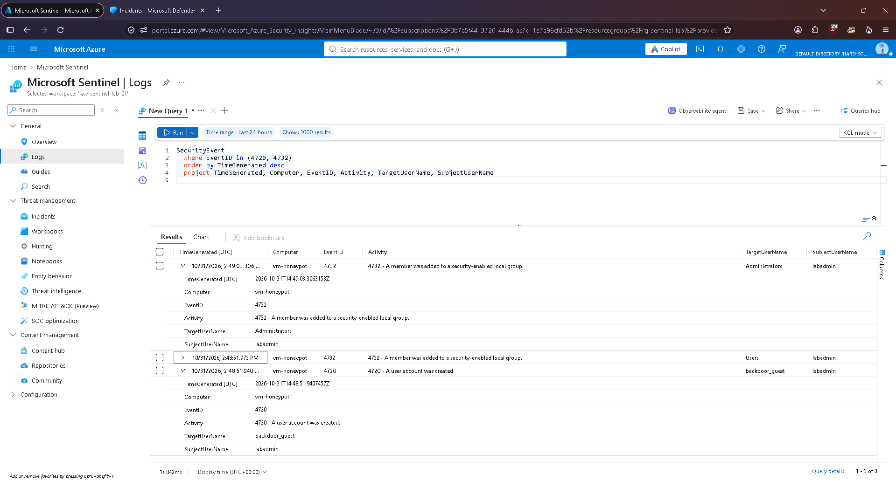
*Log query verifying Event IDs 4720 (User Created) and 4732 (Added to Security Group) captured cleanly by the AMA agent.*

---

## 🛡️ Custom Detection Engineering (KQL Rules)

I engineered 6 production-grade analytics rules in Microsoft Sentinel. Every rule includes entity mappings (Host, Account, IP) to ensure automatic correlation in Sentinel's visual graph.

### Rule 1: Potential RDP Brute Force Attack
* **MITRE ATT&CK:** `T1110.001` (Password Guessing) | **Severity:** Medium | **Schedule:** Every 5 min / 1 hr lookback
* **Engineering Challenge & Tuning:** Default queries alert on internal Windows noise (DCOM, loopback, RPC). Added strict filtering to exclude empty IPs, `-`, `127.0.0.1`, and `::1`, and set a threshold of $\ge 3$ failed logons per attacker IP.

```kql
SecurityEvent
| where TimeGenerated >= ago(1h)
| where EventID == 4625
| where isnotempty(IpAddress) and IpAddress !in ("-", "127.0.0.1", "::1")
| summarize 
    FailedCount = count(),
    StartTime = min(TimeGenerated),
    EndTime = max(TimeGenerated)
    by Computer, Account, IpAddress
| where FailedCount >= 3
| extend HostName = tostring(split(Computer, ".")[0])
```

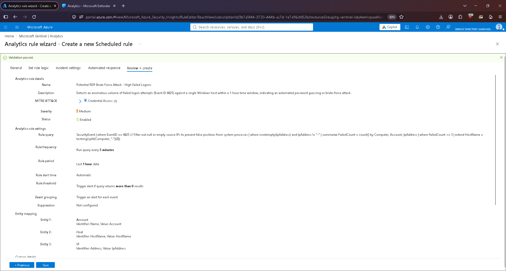
*Rule 1 validation review showing scheduled frequency, Medium severity, and entity mappings.*

### Rule 2: Brute Force Followed by Successful Logon Correlation
* **MITRE ATT&CK:** `T1110` (Brute Force) + `T1078` (Valid Accounts) | **Severity:** High | **Schedule:** Every 5 min / 1 hr lookback
* **Engineering Challenge & Tuning:** Alerting on failed logins alone leads to alert fatigue. This rule uses an `inner join` between `EventID == 4625` (3+ failures) and `EventID == 4624` (success) from the *same* external IP address where `SuccessTime >= LastFail`, catching true account compromise.

```kql
let FailedLogons = SecurityEvent
    | where TimeGenerated >= ago(1h)
    | where EventID == 4625
    | where isnotempty(IpAddress) and IpAddress !in ("-", "127.0.0.1", "::1")
    | summarize FailedCount = count(), FirstFail = min(TimeGenerated), LastFail = max(TimeGenerated) by Computer, Account, IpAddress
    | where FailedCount >= 3;
SecurityEvent
| where TimeGenerated >= ago(1h)
| where EventID == 4624
| where isnotempty(IpAddress) and IpAddress !in ("-", "127.0.0.1", "::1")
| project SuccessTime = TimeGenerated, Computer, CompromisedAccount = Account, IpAddress, LogonType
| join kind=inner (FailedLogons) on Computer, IpAddress
| where SuccessTime >= LastFail
| extend HostName = tostring(split(Computer, ".")[0])
```

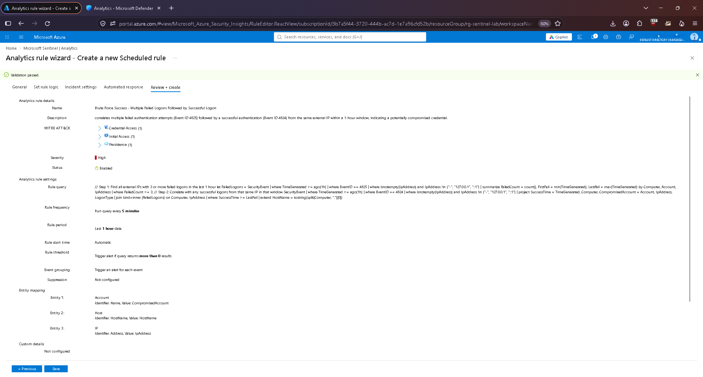
*Rule 2 validation passing review with correlation logic and High severity.*

### Rule 3: Suspicious Local Account Created & Added to Administrators
* **MITRE ATT&CK:** `T1136.001` (Local Account) + `T1098` (Account Manipulation) | **Severity:** High | **Schedule:** Every 5 min / 1 hr lookback
* **Logic:** Detects both user account creation (`Event ID 4720`) and additions to the local Administrators group (`Event ID 4732`).

```kql
SecurityEvent
| where TimeGenerated >= ago(1h)
| where EventID in (4720, 4732)
| project TimeGenerated, Computer, EventID, Activity, TargetAccount = TargetUserName, SubjectAccount = SubjectUserName, MemberName
| extend HostName = tostring(split(Computer, ".")[0])
```

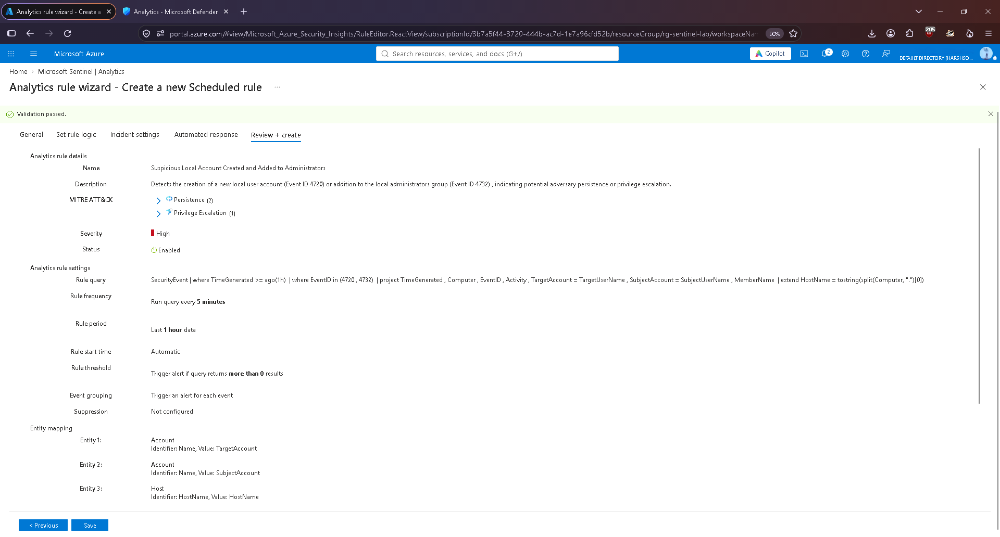
*Rule 3 review screen showing MITRE tactics Persistence and Privilege Escalation.*

### Rule 4: Suspicious Obfuscated PowerShell Execution
* **MITRE ATT&CK:** `T1059.001` (Command & Scripting: PowerShell) | **Severity:** Medium | **Schedule:** Every 5 min / 1 hr lookback
* **Logic:** Scans process creation commands (`Event ID 4688`, `4104`) for evasion flags (`-enc`, `-w hidden`, `-nop`, `downloadstring`, `iex`, `bypass`).

```kql
SecurityEvent
| where TimeGenerated >= ago(1h)
| where EventID in (4688, 4104) or EventID == 4624
| where CommandLine has_any ("-enc", "-encodedcommand", "-noni", "-w hidden", "downloadstring", "invoke-expression", "iex", "bypass")
| project TimeGenerated, Computer, Account, CommandLine, Activity
| extend HostName = tostring(split(Computer, ".")[0])
```

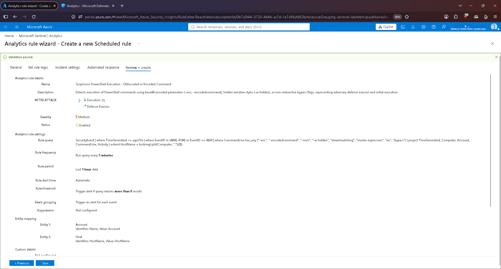
*Rule 4 validation passed for command-line execution and evasion detection.*

### Rule 5: Windows Security Event Log Cleared
* **MITRE ATT&CK:** `T1070.001` (Clear Windows Event Logs) | **Severity:** High | **Schedule:** Every 5 min / 1 hr lookback
* **Logic:** Detects Windows audit log wiping (`Event ID 1102`).

```kql
SecurityEvent
| where TimeGenerated >= ago(1h)
| where EventID == 1102
| project TimeGenerated, Computer, Account, Activity
| extend HostName = tostring(split(Computer, ".")[0])
```

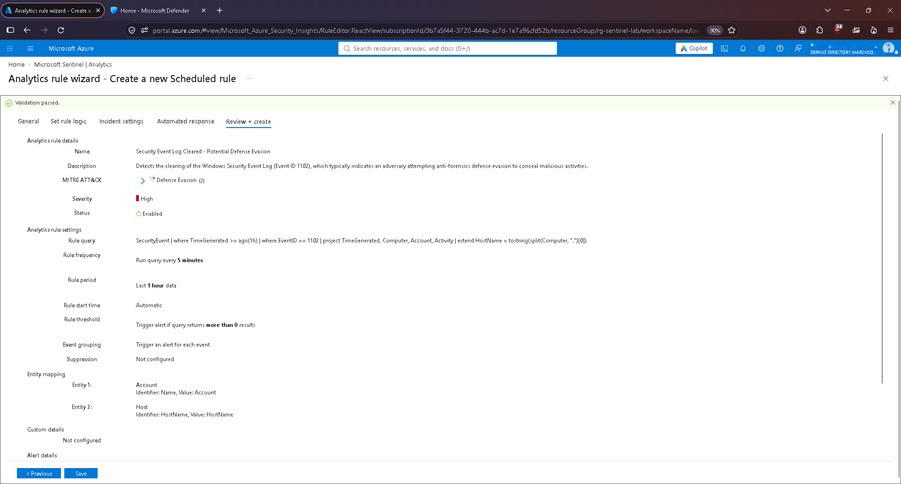
*Rule 5 validation passing review with High severity defense evasion classification.*

### Rule 6: Entra ID Impossible Travel Sign-in
* **MITRE ATT&CK:** `T1078.004` (Cloud Accounts) | **Severity:** Medium | **Schedule:** Every 15 min / 2 hr lookback
* **Logic:** Analyzes `SigninLogs` for successful authentications (`ResultType == 0`) across more than one distinct country for the same user within 2 hours.

```kql
SigninLogs
| where TimeGenerated >= ago(2h)
| where ResultType == 0
| project TimeGenerated, UserPrincipalName, IPAddress, Location = tostring(LocationDetails.countryOrRegion)
| summarize 
    LoginCount = count(), 
    DistinctCountries = dcount(Location), 
    Countries = make_set(Location), 
    IPs = make_set(IPAddress),
    FirstSeen = min(TimeGenerated),
    LastSeen = max(TimeGenerated)
    by UserPrincipalName
| where DistinctCountries > 1
```

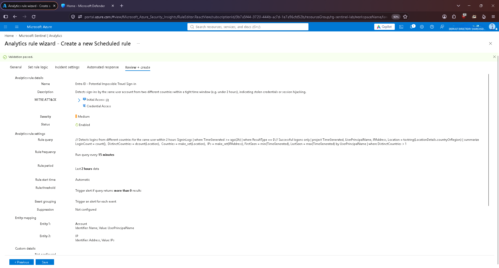
*Rule 6 validation passed for Entra ID identity anomalies and impossible travel.*

---

## 🚨 Incident Triage & Visual Graph Investigation

When the scheduled analytics rules fired, high-severity incidents populated the Sentinel **Incidents** blade.

Opening an incident revealed the mapped entities:
* **Host Entity:** `vm-honeypot`
* **Actor Account:** `labadmin`
* **Target Backdoor Account:** `hacker_persist`

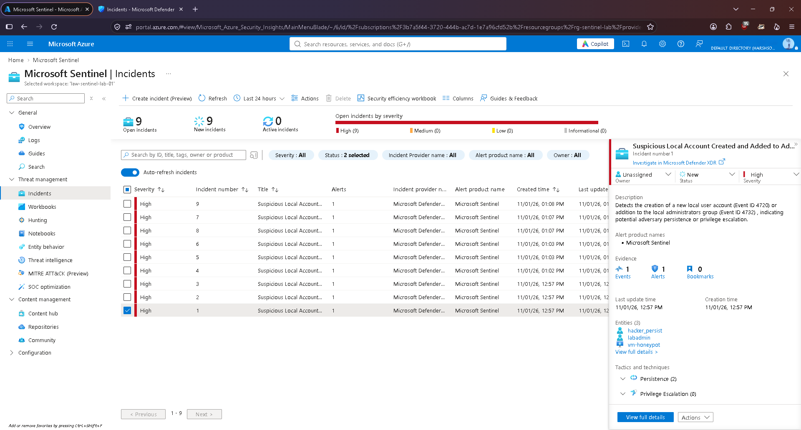
*Sentinel Incidents queue displaying triggered High-Severity alerts.*

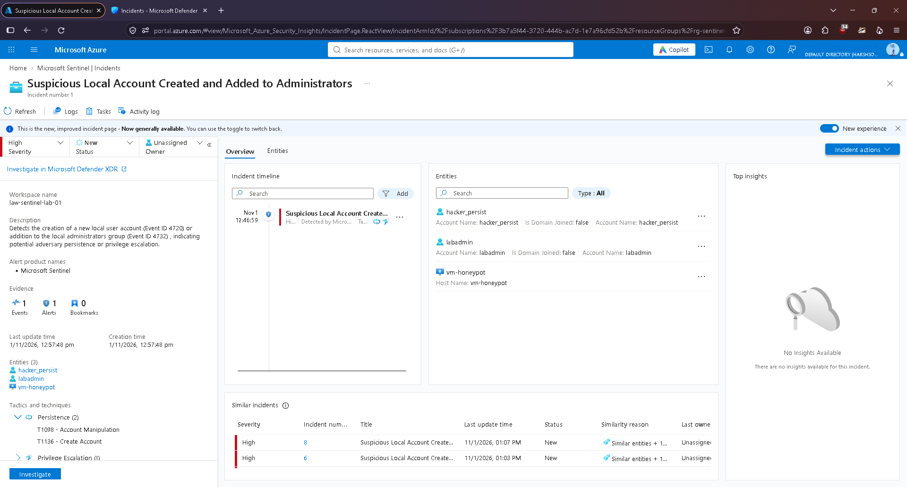
*Detailed incident pane showing mapped entities and MITRE classification.*

Clicking **Investigate** launched Sentinel's interactive node graph. Rather than digging through raw log tables, I was able to see the full attack chain visually: `labadmin` created the user, `hacker_persist` was created on `vm-honeypot`, and the account was elevated to Administrators.

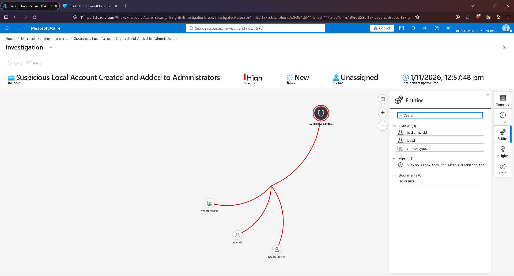
*Sentinel Visual Investigation Graph showing entity correlation across host and account nodes.*

---

## 📊 Interactive SOC Operations Dashboard (Workbook)

To provide operational oversight, I built a custom interactive Sentinel Workbook named:
`SOC Operations - Threat Telemetry & Attack Surface Dashboard`

It features:
1. **Failed Logons Over Time:** Hourly binned time-series line chart tracking attack volume spikes.
2. **Top Targeted Accounts:** Bar chart ranking which usernames attackers attempted most (`Administrator` vs `labadmin`).
3. **Geospatial Threat Map:** Leveraged KQL's `geo_info_from_ip_address(IpAddress)` to extract latitude and longitude coordinates from external IPs, plotting real-time attack markers on a 3D world map.

```kql
// World map query with coordinate extraction
SecurityEvent
| where EventID == 4625
| where isnotempty(IpAddress) and IpAddress !in ("-", "127.0.0.1", "::1")
| extend Geo = geo_info_from_ip_address(IpAddress)
| extend Latitude = toreal(Geo.latitude), Longitude = toreal(Geo.longitude), Country = tostring(Geo.country)
| summarize AttackCount = count() by IpAddress, Latitude, Longitude, Country
```

Because the dashboard scrolls vertically, it is captured below in two distinct views:

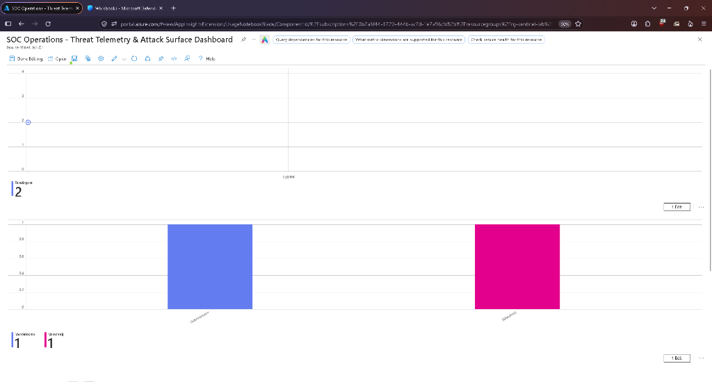
*SOC Workbook (Part 1 - Top View): Failed logons over time trendline and targeted account distribution.*

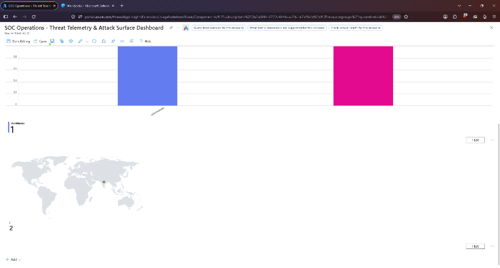
*SOC Workbook (Part 2 - Bottom View): Geospatial world threat map resolving attacker coordinates with live pin placement.*

---

## ⚡ SOAR Automated Incident Response (Azure Logic Apps)

To automate tier-1 repetitive triage, I deployed an automated incident response playbook using **Azure Logic Apps** (`Consumption` serverless tier):
* **Playbook Name:** `playbook-incident-auto-triage` in `East Asia`.
* **Trigger:** `Microsoft Sentinel incident` - fires whenever a new incident is created.
* **Action:** `Add comment to incident (V3)` - dynamically takes the `Incident ARM ID` and posts structured triage commentary, attacker verification guidance, and host containment recommendations onto the incident timeline.

```text
[SOAR AUTOMATED RESPONSE]
Playbook executed successfully.
Action taken: Incident enriched and triaged automatically.
Recommended SOC actions: Review attacker IP, inspect SAM accounts on vm-honeypot, and enforce network isolation if required.
```

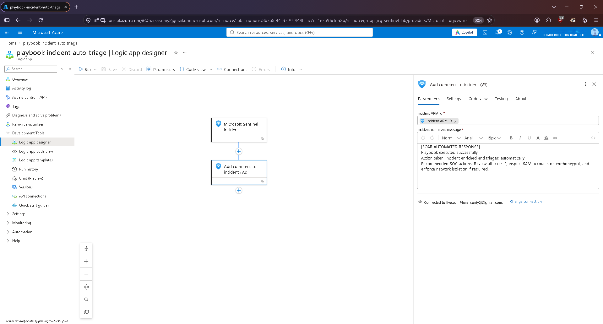
*Logic App visual workflow designer showing the Sentinel incident trigger connected to the automated comment action with dynamic Incident ARM ID binding.*

---

## 🗺️ MITRE ATT&CK Mapping Matrix

| Tactic | Technique ID | Technique Name | Analytics Rule Name | Data Source | Severity |
| :--- | :---: | :--- | :--- | :---: | :---: |
| **Credential Access** | `T1110.001` | Password Guessing | Potential RDP Brute Force Attack | `SecurityEvent` (4625) | Medium |
| **Initial Access** | `T1078` | Valid Accounts | Brute Force Success Correlation | `SecurityEvent` (4625 + 4624) | High |
| **Persistence** | `T1136.001` | Create Account: Local Account | Suspicious Local Account Created | `SecurityEvent` (4720) | High |
| **Privilege Escalation** | `T1098` | Account Manipulation | Local Admin Group Member Added | `SecurityEvent` (4732) | High |
| **Execution** | `T1059.001` | Command & Scripting: PowerShell | Obfuscated PowerShell Execution | `SecurityEvent` (4688, 4104) | Medium |
| **Defense Evasion** | `T1070.001` | Clear Windows Event Logs | Security Event Log Cleared | `SecurityEvent` (1102) | High |
| **Initial Access** | `T1078.004` | Cloud Accounts | Entra ID Impossible Travel | `SigninLogs` | Medium |

---

## ⚖️ Home Lab vs. Production Strategy

A home detection lab and an enterprise production SIEM operate under very different operational constraints. Below is an engineering comparison of what was implemented in this lab versus how it is handled in an enterprise production environment.

| Architecture Area | This Lab Implementation | Enterprise Production Implementation |
| :--- | :--- | :--- |
| **Compute & Perimeter** | Single Windows 10 VM with RDP exposed to the internet via NSG | Multi-tier DMZ, zero exposed RDP ports, Azure Bastion / VPN, and Azure Arc multi-cloud endpoints |
| **Endpoint Telemetry** | Azure Monitor Agent (AMA) collecting `SecurityEvent` table | AMA + Microsoft Defender for Endpoint (MDE) + Sysmon for granular process genealogy, network connections, and DLL loads |
| **Cost & Data Tiers** | Azure for Students subscription ($0 out-of-pocket, manual VM deallocation) | Log Analytics Commitment Tiers, Basic Logs for high-volume telemetry (firewall logs), and Data Export to ADLS Gen2 cold storage |
| **Detection Management** | Rules authored and scheduled manually in Sentinel Web GUI | Detection-as-Code (DaC) with KQL rules versioned in Git and deployed via CI/CD pipelines (GitHub Actions / Azure DevOps) |
| **Incident Investigation** | Manual graph inspection in Azure Portal | Integrated Microsoft Defender XDR incident queue, automated entity risk scoring, and unified timeline pivoting |
| **SOAR Automation** | Serverless Logic App posting static triage commentary | Multi-stage Logic App with automated user session revocation via Entra ID, attacker IP blocking on Palo Alto/Azure Firewall, and automated host isolation |
| **Identity Ingestion** | Simulated impossible travel via KQL query against `SigninLogs` | Microsoft Entra ID P2 Identity Protection risk detections streamed to Sentinel with automated Conditional Access step-up |

---

## 📁 Repository Structure

```
├── README.md                                  # Main project documentation
├── kql-rules/                                 # Standalone KQL detection rule files
│   ├── rule1_rdp_bruteforce.kql
│   ├── rule2_bruteforce_success.kql
│   ├── rule3_account_creation_persistence.kql
│   ├── rule4_powershell_obfuscated.kql
│   ├── rule5_log_cleared_defense_evasion.kql
│   └── rule6_impossible_travel.kql
├── workbook/                                  # SOC dashboard KQL queries
│   └── soc_operations_dashboard.kql
├── soar-playbook/                             # Automated incident response playbook details
│   └── README.md
└── screenshots/                               # 24 verified lab proof screenshots (01 to 23 with multi-view dashboard)
```

---

## 📸 Complete Evidence Index (24 Verified Artifacts)

Every milestone of this lab is backed by verified screenshots captured during execution:

| # | Artifact Filename | Lab Phase / Activity | Description |
| :-: | :--- | :--- | :--- |
| `01` | [`01_sentinel_workspace_initialized.png`](screenshots/01_sentinel_workspace_initialized.png) | SIEM Initialization | Microsoft Sentinel onboarded and operational on Log Analytics Workspace |
| `02` | [`02_log_analytics_workspace_overview.png`](screenshots/02_log_analytics_workspace_overview.png) | Ingestion Pipeline | Log Analytics Workspace (`law-sentinel-lab-01`) overview in East Asia |
| `03` | [`03_vm_honeypot_deployed.png`](screenshots/03_vm_honeypot_deployed.png) | Infrastructure | Windows 10 honeypot VM (`vm-honeypot`) deployment verification |
| `04` | [`04_dcr_wizard_validation_passed.png`](screenshots/04_dcr_wizard_validation_passed.png) | Telemetry Pipeline | Data Collection Rule (`dcr-windows-security-events`) validated with AMA agent |
| `05` | [`05_vm_firewall_disabled_powershell.png`](screenshots/05_vm_firewall_disabled_powershell.png) | Attack Surface | Windows Firewall disabled via PowerShell RunCommand to permit external scans |
| `06` | [`06_kali_nmap_port3389_open.png`](screenshots/06_kali_nmap_port3389_open.png) | Offensive Simulation | Kali Linux Nmap reconnaissance confirming port 3389 open and reachable |
| `07` | [`07_kali_hydra_attack_executed.png`](screenshots/07_kali_hydra_attack_executed.png) | Offensive Simulation | THC-Hydra dictionary password brute-force attack against exposed RDP |
| `08` | [`08_sentinel_kql_raw_attack_telemetry_verified.png`](screenshots/08_sentinel_kql_raw_attack_telemetry_verified.png) | Telemetry Verification | Raw Event ID 4625 brute-force telemetry verified in Sentinel KQL |
| `09` | [`09_rule1_review_create_passed.png`](screenshots/09_rule1_review_create_passed.png) | Detection Engineering | Analytics Rule 1 (Potential RDP Brute Force) validation passed |
| `10` | [`10_rule2_brute_force_success_review.png`](screenshots/10_rule2_brute_force_success_review.png) | Detection Engineering | Analytics Rule 2 (Brute Force Success Correlation) validation passed |
| `11` | [`11_rule3_account_creation_review_passed.png`](screenshots/11_rule3_account_creation_review_passed.png) | Detection Engineering | Analytics Rule 3 (Suspicious Local Account Created) validation passed |
| `12` | [`12_simulation_backdoor_account_created.png`](screenshots/12_simulation_backdoor_account_created.png) | Offensive Simulation | Execution of backdoor account creation and local admin group elevation |
| `13` | [`13_sentinel_kql_backdoor_account_events_verified.png`](screenshots/13_sentinel_kql_backdoor_account_events_verified.png) | Telemetry Verification | KQL query confirming Event IDs 4720 and 4732 ingested in Sentinel |
| `14` | [`14_sentinel_incidents_blade_triggered.png`](screenshots/14_sentinel_incidents_blade_triggered.png) | Incident Response | Microsoft Sentinel Incidents blade populated with High-Severity alerts |
| `15` | [`15_incident_full_details_entities.png`](screenshots/15_incident_full_details_entities.png) | Incident Response | Full incident details with mapped Host and Account entities |
| `16` | [`16_sentinel_investigation_graph_hero.png`](screenshots/16_sentinel_investigation_graph_hero.png) | Threat Hunting | Visual Investigation Graph showing multi-entity attack chain |
| `17a` | [`17a_sentinel_soc_workbook_dashboard_charts.png`](screenshots/17a_sentinel_soc_workbook_dashboard_charts.png) | SOC Visualization | Interactive SOC dashboard (Part 1: Logon trend line chart & targeted accounts bar chart) |
| `17b` | [`17b_sentinel_soc_workbook_dashboard_map.png`](screenshots/17b_sentinel_soc_workbook_dashboard_map.png) | SOC Visualization | Interactive SOC dashboard (Part 2: 3D geospatial attack map with live attacker IP coordinates) |
| `18` | [`18_rule4_powershell_review_passed.png`](screenshots/18_rule4_powershell_review_passed.png) | Detection Engineering | Analytics Rule 4 (Obfuscated PowerShell Execution) validation passed |
| `19` | [`19_powershell_obfuscated_attack_executed.png`](screenshots/19_powershell_obfuscated_attack_executed.png) | Offensive Simulation | Execution of encoded PowerShell payload on VM |
| `20` | [`20_rule5_log_cleared_review.png`](screenshots/20_rule5_log_cleared_review.png) | Detection Engineering | Analytics Rule 5 (Security Event Log Cleared) validation passed |
| `21` | [`21_simulation_log_cleared_executed.png`](screenshots/21_simulation_log_cleared_executed.png) | Offensive Simulation | Execution of `wevtutil cl Security` (Event ID 1102) on VM |
| `22` | [`22_rule6_impossible_travel_review.png`](screenshots/22_rule6_impossible_travel_review.png) | Detection Engineering | Analytics Rule 6 (Entra ID Impossible Travel) validation passed |
| `23` | [`23_logic_app_soar_playbook_designer.png`](screenshots/23_logic_app_soar_playbook_designer.png) | SOAR Automation | Sentinel Incident Trigger + Add Comment action configured & saved |

---

## 💡 Key Takeaways & Lessons Learned

1. **Noise is the Biggest Problem in SIEM Engineering:** Default security event queries pick up tons of internal noise (local system processes, DCOM, loopback IPs). Adding strict IP validation (`isnotempty`, excluding `-`, `127.0.0.1`, `::1`) cut out false positives without missing real external attacks.
2. **Correlation Over Static Alerts:** Alerting on 3 failed logins is good, but correlating failed logins with a subsequent successful login using a KQL `inner join` separates mundane scanning from an actual critical breach.
3. **Visual Graphs Beat Manual Log Review:** Investigating an incident via Sentinel's graph made it immediately obvious who created the backdoor account and on which host, cutting triage time down from manual cross-table querying to seconds.
4. **Cloud Cost Governance is Essential:** Running virtual machines in the cloud without shutdown policies drains credits quickly. Automating nightly shutdown and deallocating the VM after testing kept my entire lab running at zero out-of-pocket cost.

---

## 🛠️ Skills Demonstrated

* **Cloud SIEM Architecture:** Deploying, configuring, and scaling Microsoft Sentinel on Azure Log Analytics Workspace.
* **Modern Telemetry Pipelines:** Migrating from legacy MMA to Azure Monitor Agent (AMA) with Data Collection Rules (DCR).
* **Detection Engineering (KQL):** Writing multi-table correlation queries, inner joins, time-series binning, and geo-enrichment functions.
* **Adversary Simulation:** Executing automated dictionary attacks (THC-Hydra), persistence mechanisms, and defense evasion techniques from Kali Linux.
* **Incident Response & Triage:** Graph-based root cause analysis, entity mapping (Host, Account, IP), and incident severity classification.
* **SOAR Automation:** Visual workflow design with Azure Logic Apps for serverless incident enrichment.
* **Cost & Quota Governance:** Navigating Azure subscription policy limits, regional quota management, and compute deallocation.

---

## 🚀 Future Improvements & Roadmap

- [ ] Deploy **Sysmon** with the SwiftOnSecurity configuration to ingest Event ID 1 (Process Creation with Hash) and Event ID 3 (Network Connections).
- [ ] Implement **Detection-as-Code (DaC)** using GitHub Actions to automatically validate and deploy KQL analytic rules via ARM/Bicep templates.
- [ ] Integrate **Microsoft Defender for Endpoint (MDE)** for automated host isolation directly triggered by Sentinel incidents.
- [ ] Create an automated IP containment playbook using Azure Logic Apps to dynamically append attacker IPs to an Azure Network Security Group deny rule.
- [ ] Connect multi-cloud telemetry sources (AWS CloudTrail, GCP Audit Logs) into Sentinel via data connectors.

---

## 📚 References

* [Microsoft Sentinel Documentation](https://learn.microsoft.com/en-us/azure/sentinel/)
* [Azure Monitor Agent Overview](https://learn.microsoft.com/en-us/azure/azure-monitor/agents/azure-monitor-agent-overview)
* [Kusto Query Language (KQL) Reference](https://learn.microsoft.com/en-us/azure/data-explorer/kusto/query/)
* [MITRE ATT&CK Framework](https://attack.mitre.org/)
* [THC-Hydra Network Logon Cracker](https://github.com/vanhauser-thc/thc-hydra)

---

## 👤 Author

**Harsh Soni**  
*Aspiring Cybersecurity Analyst & Detection Engineer*  
[GitHub Profile](https://github.com/harshhhhh10)
